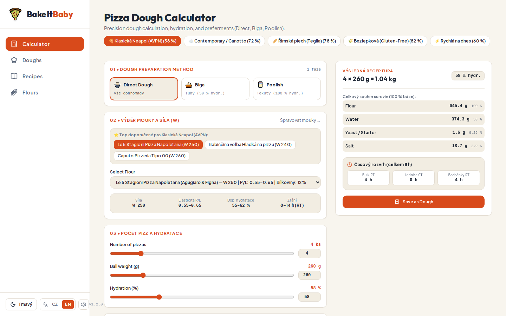
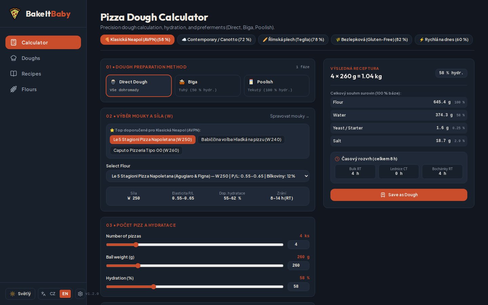

<p align="center">
  
</p>

# BakeItBaby

> **Precision Pizza Dough Calculator, Fermentation Planner & Flour Workbench**  
> A minimalistic, responsive, and bilingual web application designed for passionate pizza makers, home bakers, and pizzaiolos.

[](LICENSE)
[](https://github.com/AdamHolman1988/bakeitbaby/actions/workflows/ci.yml)
[](#tech-stack)
[](#tech-stack)
[](#tech-stack)

<p align="center">
  
  
</p>

---

## About BakeItBaby

**BakeItBaby** bridges artisan pizza tradition and food science into a quiet, clean, and minimalist digital workbench. Instead of generic dough calculators that treat every flour the same, BakeItBaby factors in:
- **Flour Strength ($W$ index)** & **Elasticity ($P/L$ ratio)**
- **Method Formulation**: Direct Dough, **Biga** (45% stiff preferment), and **Poolish** (1:1 liquid preferment) with exact two-phase ingredient schedules.
- **Top 3 Recommended Flours** for each pizza style (*Classic Neapolitan*, *Contemporary / Canotto*, *Roman Pan / Teglia*, *Gluten-Free*, *Quick Same-Day*).
- **Separation of Concerns**: Saved dough blueprints (**Doughs**) vs. full pizza cookbook recipes (**Recipes**) with toppings and oven parameters.

---

## Application Modules & Structure

- **1. Calculator (Precision Dough Calculator)**:
  - **Method Selector**: Switch seamlessly between **Direct Dough**, **Biga**, and **Poolish**.
  - **Two-Phase Calculation Breakdown**:
    - **Phase 1 (Preferment)**: Exact flour, water, yeast, and temperature schedule (e.g. 1h RT + 16–24h fridge).
    - **Phase 2 (Final Dough)**: Remaining flour, cold/ice water, salt, oil/malt, and mixing instructions.
  - **Style Presets & Top 3 Recommended Flours**: One-click quick selection of the 3 best flours for each style.
  - Only flours enabled via *In Calculator* appear in the calculator dropdown.

- **2. Doughs (Dough Formulations Workbench)**:
  - Catalog of saved dough formulas (AVPN Neapolitan, Canotto 72%, 100% Biga, Poolish, Roman Teglia, Gluten-Free).
  - Baker's percentages, preferment ratios, room-temp (RT) and cold-temp (CT) fermentation schedules.
  - One-click button to reload any formulation back into the Calculator for batch re-scaling.

- **3. Recipes (Pizza Cookbook)**:
  - Full pizza recipes (Margherita Verace, Marinara Tradizionale, Diavola with 'Nduja, Mortadella & Burrata & Pistachio, Quattro Formaggi, Gluten-Free Margherita).
  - Ingredient & toppings lists divided by stage (*base*, *before baking*, *after baking*).
  - Baking parameters: oven temperature (e.g. 450 °C pizza oven vs. 250 °C home oven) and baking time (seconds).
  - Optional link to a specific dough formula or standalone (*Custom Dough*).

- **4. Flours (Flour Registry & Table)**:
  - **Single-row-per-flour compact table**: Brand, Name, Type, $W$ Index, Elasticity ($P/L$), Protein %, Hydration %, Maturation, and *In Calculator* toggle switch.
  - Detailed slide-over/modal profile for technical usage notes, descriptions, and recommended recipes.
  - Pre-seeded with benchmark flours: **Caputo Nuvola Super** ($W\sim 330$, $P/L\sim 0.50\text{–}0.60$), **Caputo Fioreglut (Gluten-Free)**, Caputo Pizzeria, Caputo Cuoco, Manitoba Oro, Le 5 Stagioni, and Babiččina volba.

- **Minimalist, Calm & Readable UI**:
  - Artisan, quiet surfaces with subtle borders (no loud, disco-like neon outlines).
  - Dual themes: Light Mode (*Modern Vibrant Artisan*) and Dark Mode (*Modern Rustic*).
  - Typography: **Outfit** for headings and **Plus Jakarta Sans** for clear technical text.
  - Fluid wide layout with responsive navigation drawer for tablets and mobile devices.

- **Bilingual (CZ & EN)**:
  - Instant one-click language toggle between Czech (`cs`) and English (`en`) across all views.

---

## Flour Strength ($W$) & Elasticity ($P/L$) Reference Guide

| $W$ Index | Elasticity ($P/L$) | Strength | Ideal Hydration | Maturation | Typical Use |
|:---:|:---:|:---:|:---:|:---:|:---|
| **W 160–200** | 0.50 | Weak | 50–55 % | 2–4 h (RT) | Biscuits, grissini, quick thin doughs |
| **W 220–260** | 0.50–0.60 | Medium | 55–62 % | 8–14 h (RT) | Faster same-day pizza, direct dough |
| **W 270–310** | 0.50–0.60 | Strong | 60–70 % | 24–48 h (cold) | Classic Neapolitan pizza, focaccia |
| **W 320–380+** | 0.50–0.80 | Manitoba / Super Cloud | 70–85+ % | 48–72 h (cold) | Contemporary Canotto, Biga, Poolish, 75%+ hydration |
| **Gluten-Free** | N/A | Gluten-free (Fioreglut) | 80–85 % | 3–24 h | Gluten-free pizza, focaccia for coeliacs |

---

## Safe Port Allocation (Zero Host Collisions)

BakeItBaby runs safely alongside your other projects and native services:

| Service | Port | Notes |
|---|---|---|
| **PostgreSQL 17** | `127.0.0.1:5435` | Container `bakeitbaby-database` (avoids host 5432 and other docker 5433) |
| **Symfony 7.4 API** | `127.0.0.1:8001` | REST JSON backend (avoids port 8000/8080) |
| **Next.js 16 Web** | `http://localhost:3005` | Turbopack frontend (avoids port 3000) |

---

## Quickstart & Global CLI Command

Run the global runner anytime from your terminal:
```bash
bakeitbaby
```
Or start the dev script directly:
```bash
./scripts/dev.sh
```

To run the complete automated test suite (database check, PHPStan level 8, PHPUnit, Vitest, and Next.js production build):
```bash
./scripts/test-all.sh
```

---

## License

This project is licensed under the **MIT License** — feel free to fork, customize, and share. See [LICENSE](LICENSE) for details.
