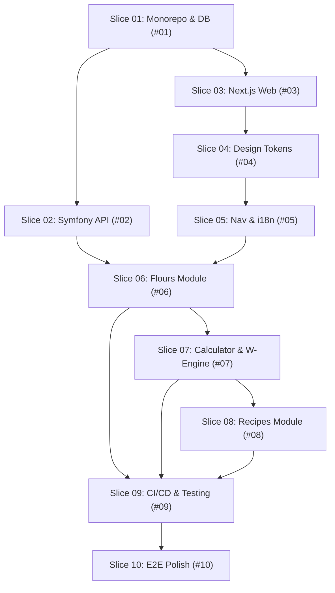

# BakeItBaby — Roadmap & Delivery Plan

> **Pizza Dough & Flour Application (PHP + PostgreSQL + TypeScript)**
> Minimalistic, responsive, bilingual pizza formulation workstation with W-index fermentation engine.

## How to use this file

| You want to… | Do this |
|---|---|
| See what is planned or in progress | Read the **Open Items** table below |
| Read detailed acceptance criteria | Open [`docs/roadmap/items/<id>.md`](docs/roadmap/items/) |
| Read architectural decisions | Check [`docs/adr/`](docs/adr/) |
| Verify system health & run test suites | Run `./scripts/test-all.sh` |

## Legend

- ✅ `shipped` — completed with automated test verification
- 🔧 `in_progress` — currently being implemented
- 🔲 `todo` — planned, ready to start
- 🚨 `blocking` — prerequisite for subsequent slices
- ⏳ `deferred` — scheduled for future phase

---

## Delivery Roadmap — Slices Overview

---

## Roadmap Items

| ID | Status | Priority | Title | ADR | Item Spec |
|---|:---:|:---:|---|---|---|
| `#01` | ✅ shipped | P0 | Monorepo Foundation & Containerized Database (Port 5435) | [ADR 0001](docs/adr/0001-architecture-stack-and-workspace.md) | [`#01`](docs/roadmap/items/01-monorepo-foundation-and-database.md) |
| `#02` | ✅ shipped | P0 | Backend API Scaffold (Symfony 7.4 & Doctrine ORM) | [ADR 0001](docs/adr/0001-architecture-stack-and-workspace.md), [ADR 0006](docs/adr/0006-postgresql-data-model-and-persistence.md) | [`#02`](docs/roadmap/items/02-backend-api-scaffold.md) |
| `#03` | ✅ shipped | P0 | Frontend Scaffold (Next.js 16, Turbopack, TypeScript, Vitest) | [ADR 0001](docs/adr/0001-architecture-stack-and-workspace.md), [ADR 0002](docs/adr/0002-design-tokens-and-typography.md) | [`#03`](docs/roadmap/items/03-frontend-scaffold-and-tooling.md) |
| `#04` | ✅ shipped | P0 | Design System & Theme Tokens (Vibrant Light & Rustic Dark) | [ADR 0002](docs/adr/0002-design-tokens-and-typography.md) | [`#04`](docs/roadmap/items/04-design-system-and-theme-tokens.md) |
| `#05` | ✅ shipped | P0 | Left Navigation Shell & Bilingual i18n (CZ/EN) | [ADR 0003](docs/adr/0003-navigation-and-layout-hierarchy.md), [ADR 0005](docs/adr/0005-internationalization-strategy.md) | [`#05`](docs/roadmap/items/05-left-navigation-shell-and-i18n.md) |
| `#06` | ✅ shipped | P1 | Flours Module (Database, Seed Data, API & Management UI) | [ADR 0004](docs/adr/0004-dough-math-and-fermentation-engine.md), [ADR 0006](docs/adr/0006-postgresql-data-model-and-persistence.md) | [`#06`](docs/roadmap/items/06-flours-module-crud-and-strength-table.md) |
| `#07` | ✅ shipped | P1 | Pizza Dough Calculator & W-Strength Fermentation Engine | [ADR 0004](docs/adr/0004-dough-math-and-fermentation-engine.md) | [`#07`](docs/roadmap/items/07-pizza-dough-calculator-and-fermentation-engine.md) |
| `#08` | ✅ shipped | P1 | Recipes Module (Database, API & Management UI) | [ADR 0006](docs/adr/0006-postgresql-data-model-and-persistence.md) | [`#08`](docs/roadmap/items/08-recipes-module-crud.md) |
| `#09` | ✅ shipped | P1 | CI/CD Pipeline & Automated Testing Matrix | [ADR 0007](docs/adr/0007-testing-strategy-and-ci-cd.md) | [`#09`](docs/roadmap/items/09-ci-cd-pipeline-and-automated-testing.md) |
| `#10` | ✅ shipped | P2 | Full End-to-End Verification, Performance & Documentation | [ADR 0001](docs/adr/0001-architecture-stack-and-workspace.md) | [`#10`](docs/roadmap/items/10-full-e2e-verification-and-polish.md) |

---

## Flour Strength & Fermentation Reference Standard

The application encodes the following canonical Flour Strength ($W$) matrix:

| Index $W$ | Strength / Síla | Ideal Hydration | Fermentation Duration | Typical Usage |
|:---:|:---:|:---:|:---:|:---|
| **W 160–200** | Slabá (Weak) | 50–55 % | 2–4 hours (Room Temp) | Cookies, grissini, quick thin doughs |
| **W 220–260** | Střední (Medium) | 55–60 % | 8–14 hours (Room Temp) | Same-day direct dough, quick pizza |
| **W 270–310** | Silná (Strong) | 60–70 % | 24–48 hours (Cold Fermentation) | Classic Neapolitan pizza, focaccia |
| **W 320–380+** | Velmi silná (Manitoba) | 70–85+ % | 48–72 hours (Cold Fermentation) | Biga, poolish, high hydration (75 %+) |
